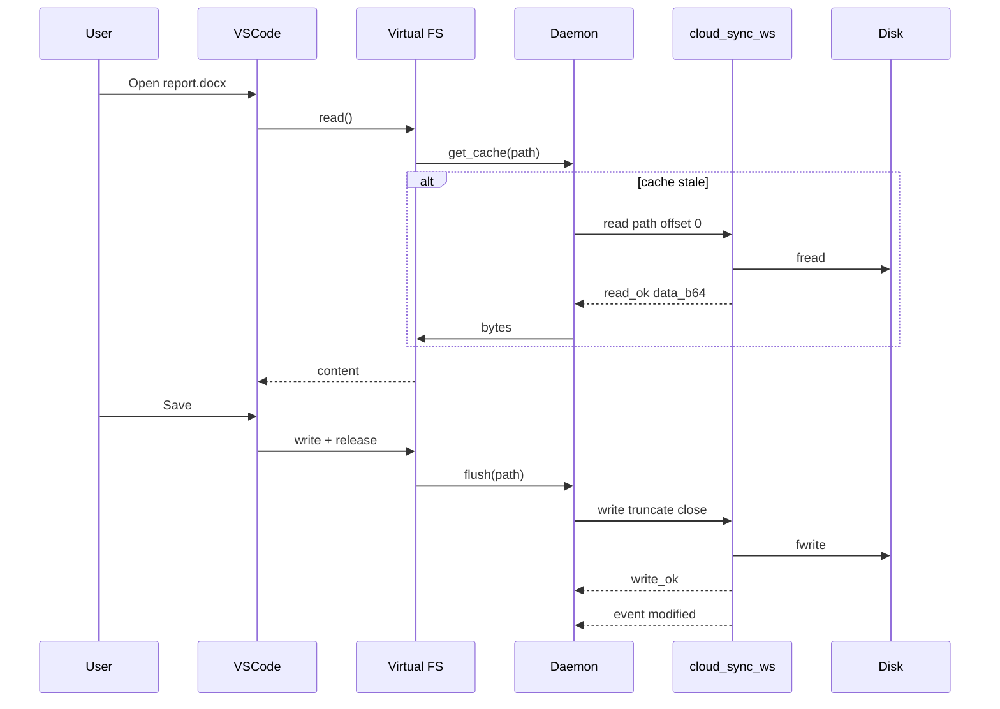

# Cloud Virtual Folder SDK — полная спецификация синхронизации

**Этот один файл содержит всё необходимое**, чтобы создать рабочее приложение синхронизации (включая готовый клиент Python без внешних библиотек — см. [§16](#16-готовое-приложение-один-файл-cloud_sync_clientpy)).

Синхронизация — **WebSocket (WSS)** через HTTPS-туннель. HTTP `sync_manifest` / `sync_manifest_client` **отключены** (410).

---

## 0. Развёртывание на сервере (текущая конфигурация)

### Порты WebSocket (без конфликтов)

| Сервис | Путь Apache | Порт localhost | Unit |
|--------|-------------|----------------|------|
| SSH terminal | `/ssh-ws` | 8765 | `ap-ssh-ws` |
| Smart Home | `/smart-home-ws` | 8766 | `smart-home-ws` |
| Monaco collab | `/cloud-collab-ws` | 8767 | (отдельный процесс) |
| **Cloud Sync** | **`/cloud-sync-ws`** | **8770** | **`cloud-sync-ws`** |

Порт **8771** — UDP notify (опционально). Порты **8770+** не пересекаются с 8765–8767.

### Команды управления

```bash
sudo systemctl status cloud-sync-ws    # статус
sudo systemctl restart cloud-sync-ws   # перезапуск
ss -lntp | grep 8770                   # слушает 127.0.0.1:8770
```

Файл unit: `apps/cloud/cloud-sync-ws.service` → `/etc/systemd/system/cloud-sync-ws.service`.

### Публичные URL (подставьте свой Host)

| Назначение | URL |
|------------|-----|
| Bootstrap | `https://ВАШ_ХОСТ/apps/cloud/sync_bootstrap.php` |
| WebSocket | `wss://ВАШ_ХОСТ/cloud-sync-ws` |
| Токены (веб) | Cloud → Manage Sync Tokens |

Apache (`/etc/apache2/sites-available/appdashboard.conf`):

```apache
ProxyPass /cloud-sync-ws ws://127.0.0.1:8770/
ProxyPassReverse /cloud-sync-ws ws://127.0.0.1:8770/
```

### Быстрый тест

```bash
curl -sS -H "X-Client-Auth: ВАШ_ТОКЕН" "https://ВАШ_ХОСТ/apps/cloud/sync_bootstrap.php"
# ok:true, ws_url содержит /cloud-sync-ws
```

---

## 1. Архитектура

```
┌─────────────────────────────────────────────────────────────────────────┐
│  Windows / Linux desktop                                                │
│  ┌──────────────────┐    ┌─────────────────────┐    ┌───────────────┐ │
│  │ Explorer / Nautilus│◄──│ Virtual FS layer    │◄──│ Sync daemon   │ │
│  │ (редакт. файлов)  │    │ WinFsp / FUSE       │    │ WebSocket    │ │
│  └──────────────────┘    └─────────────────────┘    └───────┬───────┘ │
└────────────────────────────────────────────────────────────│──────────┘
                                                             │ WSS
                                                             ▼
┌─────────────────────────────────────────────────────────────────────────┐
│  HTTPS reverse proxy (туннель)                                          │
│  ProxyPass /cloud-sync-ws → ws://127.0.0.1:8770                          │
└────────────────────────────────────────────────────────────│──────────┘
                                                             ▼
┌─────────────────────────────────────────────────────────────────────────┐
│  cloud_sync_ws.php (CLI daemon, порт 8770)                              │
│  • auth по X-Client-Auth токену                                         │
│  • manifest / read / write / mkdir / delete / rename                    │
│  • push событий другим клиентам того же пользователя                  │
└────────────────────────────────────────────────────────────│──────────┘
                                                             │
┌────────────────────────────────────────────────────────────▼──────────┐
│  PHP API (api.php) + диск storage/users/{user}/.clientsync/           │
│  • веб-редактор, загрузки, AI — публикуют события в sync bus            │
└─────────────────────────────────────────────────────────────────────────┘
```

### Компоненты на сервере

| Файл | Назначение |
|------|------------|
| `scripts/cloud_sync_ws.php` | Долгоживущий WebSocket-сервер (CLI) |
| `sync_bootstrap.php` | Одноразовый HTTP: URL WSS, версия протокола, режим sync |
| `includes/cloud_sync_protocol.php` | Константы и кодирование сообщений |
| `includes/cloud_sync_engine.php` | Операции с файлами (manifest, read, write, …) |
| `includes/cloud_sync_bus.php` | Очередь событий между PHP API и WS |
| `api.php` → `append_sync_log()` | Публикует событие при изменении файла через веб |

### Рекомендуемый корень синхронизации

По умолчанию клиент подключается к root **`clientsync`** (на диске: `storage/users/{username}/.clientsync/`). В веб-интерфейсе это раздел «Client Sync». Путь `clientsync/ProjectA` в API соответствует `base_path=ProjectA` при auth.

---

## 2. Ограничение: только HTTPS-туннели

Прямой TCP с интернета на порт 8770 **не обязателен**. Типовая схема:

1. Демон слушает **только localhost**: `php scripts/cloud_sync_ws.php 127.0.0.1 8770`
2. Reverse proxy принимает **WSS** снаружи и проксирует Upgrade на `127.0.0.1:8770`
3. Клиент подключается к `wss://ваш-домен/cloud-sync-ws`

WebSocket — стандартное расширение HTTP/1.1; любой туннель, который пропускает HTTPS с `Upgrade: websocket`, подходит.

### Пример nginx

```apache
ProxyPass /cloud-sync-ws ws://127.0.0.1:8770/
ProxyPassReverse /cloud-sync-ws ws://127.0.0.1:8770/
```

```nginx
location /cloud-sync-ws {
    proxy_pass http://127.0.0.1:8770;
    proxy_http_version 1.1;
    proxy_set_header Upgrade $http_upgrade;
    proxy_set_header Connection "upgrade";
    proxy_read_timeout 86400;
}
```

Переменная окружения (уже в systemd):

```bash
export CLOUD_SYNC_WS_PUBLIC_PATH=/cloud-sync-ws
```

### systemd unit (сервер)

```ini
[Unit]
Description=Cloud Sync WebSocket
After=network.target

[Service]
Type=simple
WorkingDirectory=/path/to/apps/cloud
ExecStart=/usr/bin/php scripts/cloud_sync_ws.php 127.0.0.1 8770
Restart=always
Environment=CLOUD_SYNC_WS_PORT=8770

[Install]
WantedBy=multi-user.target
```

---

## 3. Аутентификация

### Получение токена

1. Пользователь входит в веб Cloud.
2. Настройки → **Manage Sync Tokens** → Generate.
3. API: `POST api.php` с `action=client_token_generate&device_id=...&device_name=...&platform=Windows|Linux`
4. Ответ содержит одноразимый **`token`** (64 hex символа). Сохранить локально в защищённом хранилище (keyring / Credential Manager).

### Использование токена

- HTTP bootstrap: заголовок `X-Client-Auth: <token>`
- WebSocket: первое сообщение после connect — `op: auth` с полем `token` (см. ниже)

Токен хранится на сервере как SHA-256 hash; отзыв — `client_token_revoke` / `client_token_revoke_all`.

---

## 4. Bootstrap (HTTP, один раз при старте)

```
GET /apps/cloud/sync_bootstrap.php
Header: X-Client-Auth: <token>
```

Пример ответа:

```json
{
  "ok": true,
  "protocol": 1,
  "transport": "websocket",
  "ws_url": "wss://example.com/cloud-sync-ws",
  "ws_path": "/cloud-sync-ws",
  "chunk_bytes": 262144,
  "manifest_page": 500,
  "allowed_roots": ["main", "archive", "temp", "documents", "photos", "pdf", "trash", "clientsync"],
  "default_root": "clientsync",
  "sync_mode": "mtime_size",
  "deprecated_http_actions": ["sync_manifest", "sync_manifest_client"]
}
```

`sync_mode`:

- `mtime_size` — сравнение по mtime (мс) + size
- `mtime_size_hash` — дополнительно SHA-1 в manifest

---

## 5. WebSocket протокол (v1)

Все сообщения — **JSON text frames**, UTF-8. Рекомендуется поле `req_id` (UUID) для сопоставления запрос/ответ.

### 5.1. Подключение и auth

**Клиент → сервер** (первое сообщение после handshake):

```json
{
  "op": "auth",
  "req_id": "550e8400-e29b-41d4-a716-446655440000",
  "token": "abcdef...",
  "device_id": "machine-uuid",
  "root": "clientsync",
  "base_path": ""
}
```

| Поле | Описание |
|------|----------|
| `root` | Один из `allowed_roots`; для десктопа обычно `clientsync` |
| `base_path` | Подпапка внутри root, без `..` (например `Projects/2026`) |

**Сервер → клиент** (успех):

```json
{
  "op": "auth_ok",
  "req_id": "...",
  "protocol": 1,
  "user": "user_example_com",
  "email": "user@example.com",
  "root": "clientsync",
  "base_path": "",
  "sync_mode": "mtime_size",
  "ws_path": "/cloud-sync-ws"
}
```

**Ошибка:**

```json
{
  "op": "error",
  "code": "auth_failed",
  "message": "Invalid or expired token",
  "req_id": "..."
}
```

### 5.2. Manifest (полная или инкрементальная инвентаризация)

**Запрос:**

```json
{
  "op": "manifest_request",
  "req_id": "...",
  "offset": 0,
  "limit": 500
}
```

**Ответ** (страница):

```json
{
  "op": "manifest",
  "req_id": "...",
  "root": "clientsync",
  "base_path": "",
  "sync_mode": "mtime_size",
  "offset": 0,
  "total": 1203,
  "done": false,
  "entries": [
    {
      "path": "docs/readme.md",
      "type": "file",
      "mtime": 1716631200,
      "mtime_ms": 1716631200123,
      "size": 4096,
      "sha1": "..."
    }
  ],
  "generated_at": 1716632000
}
```

Повторять `manifest_request` с `offset += len(entries)` пока `done: true`.

### 5.3. Чтение файла (для виртуальной ФС)

**Запрос:**

```json
{
  "op": "read",
  "req_id": "...",
  "path": "docs/readme.md",
  "offset": 0,
  "length": 262144
}
```

**Ответ:**

```json
{
  "op": "read_ok",
  "path": "docs/readme.md",
  "offset": 0,
  "data_b64": "SGVsbG8=",
  "bytes": 5,
  "eof": true,
  "size": 5
}
```

Читать чанками до `eof: true`. Максимальный размер чанка: `chunk_bytes` из bootstrap (262144).

### 5.4. Запись файла

**Запрос** (создание или дозапись):

```json
{
  "op": "write",
  "req_id": "...",
  "path": "docs/new.txt",
  "offset": 0,
  "truncate": true,
  "close": true,
  "data_b64": "SGVsbG8gV29ybGQ="
}
```

| Поле | Описание |
|------|----------|
| `truncate` | `true` — перезаписать с нуля; `false` — открыть и писать с `offset` |
| `close` | `true` — после записи опубликовать событие `modified` другим клиентам |

**Ответ:**

```json
{
  "op": "write_ok",
  "path": "docs/new.txt",
  "bytes": 12,
  "mtime_ms": 1716632100456,
  "size": 12
}
```

### 5.5. Каталоги и метаданные

**mkdir:**

```json
{ "op": "mkdir", "path": "docs/sub" }
```

**delete:**

```json
{ "op": "delete", "path": "docs/old.txt", "is_dir": false }
```

**rename:**

```json
{ "op": "rename", "from": "docs/a.txt", "to": "docs/b.txt" }
```

### 5.6. События в реальном времени

Сервер **сам пушит** при изменениях через веб или другой клиент:

```json
{
  "op": "event",
  "ts": 1716632200,
  "root": "clientsync",
  "kind": "modified",
  "path": "docs/readme.md",
  "entry": { "path": "...", "mtime_ms": 123, "size": 100 }
}
```

Типы `kind`: `created`, `modified`, `deleted`, `moved`.

Дополнительно клиент может опросить:

```json
{ "op": "events_poll", "offset": 12345 }
```

Ответ: `{ "op": "events", "offset": 12600, "events": [ ... ] }`.

### 5.7. Keepalive

```json
{ "op": "ping", "req_id": "..." }
```

Ответ: `{ "op": "pong", "ts": 1716632300 }`.

Рекомендуется ping каждые 30 с; proxy timeout — не менее 86400 с.

---

## 6. Алгоритм синхронизации (клиент)

### 6.1. Локальное состояние

Храните SQLite или JSON:

```sql
CREATE TABLE local_files (
  rel_path TEXT PRIMARY KEY,
  size INTEGER,
  mtime_ms INTEGER,
  sha1 TEXT,
  state TEXT  -- 'synced' | 'dirty' | 'conflict' | 'deleted_local'
);
```

Плюс очередь исходящих операций `outbox`.

### 6.2. Первый запуск

1. `sync_bootstrap.php` → `ws_url`, `sync_mode`
2. WebSocket connect + `auth`
3. Цикл `manifest_request` до `done`
4. Для каждого `entry` без локальной копии или с устаревшим mtime — `read` чанками → записать в кэш виртуальной ФС
5. Построить индекс в БД

### 6.3. Периодическая сверка

Каждые N секунд (или по событию `event`):

1. Полный manifest **или** применить только `event` (быстрее)
2. Сравнить с локальным индексом:
   - Сервер новее → download (`read`)
   - Локаль новее (`dirty`) → upload (`write`)
   - Оба изменились → **конфликт** (см. §7)

### 6.4. Локальное изменение (виртуальная папка)

Когда пользователь сохраняет файл в Explorer:

1. FUSE/WinFsp callback `write` / `release`
2. Пометить `dirty`, положить в `outbox`
3. Демон отправляет `write` с `truncate`/`offset` по мере накопления данных
4. После успеха — `state=synced`, обновить mtime_ms из `write_ok`

### 6.5. Удаление и переименование

Локальный `unlink` → `delete` на сервер.  
Локальный `rename` → `rename` на сервер.  
Входящий `event` с `kind=deleted` → удалить из кэша и индекса.

---

## 7. Разрешение конфликтов

При `sync_mode=mtime_size`:

| Локальный | Сервер | Действие |
|-----------|--------|----------|
| нет | есть | download |
| есть | нет | upload (или delete на сервере если локально удалён) |
| mtime_ms больше | mtime_ms меньше | upload |
| mtime_ms меньше | mtime_ms больше | download |
| равны, size разный | — | download + сохранить локальный как `path (conflict YYYY-MM-DD).ext` |

При `mtime_size_hash` — если mtime и size совпали, но sha1 разный → конфликт.

Рекомендация UX как у OneDrive: не перезаписывать молча; создать копию с суффиксом.

---

## 8. Виртуальная папка — реализация клиента

Цель: пользователь видит диск `Cloud (Y:)` / `~/Cloud` и открывает файлы в Word, VS Code, bash без ручного «скачать/загрузить».

### 8.1. Модель «как OneDrive»

OneDrive на Windows использует **Cloud Files API (CfAPI)** — файлы могут быть placeholder (только метаданные) и подгружаются по открытию. Минимально жизнеспособный вариант:

- **Полный локальный кэш** в `%LOCALAPPDATA%/CloudSync/cache` или `~/.cache/cloud-sync`
- FUSE/WinFsp монтирует этот каталог **или** проксирует операции напрямую в WS

Для редактирования без сюрпризов проще **полный кэш** + фоновая синхронизация.

### 8.2. Linux — FUSE (libfuse)

Стек: `cloud-sync-daemon` (Go/Rust/C++) + `fuse3`.

Минимальные операции:

| FUSE | WebSocket |
|------|-----------|
| `getattr` | stat из локального индекса; если нет — manifest + entry |
| `open` + `read` | `read` чанками, кэшировать страницу |
| `write` | буфер → при `release` → `write` |
| `create` / `mkdir` | `write` / `mkdir` |
| `unlink` / `rmdir` | `delete` |
| `rename` | `rename` |

Пример монтирования:

```bash
cloud-fuse --mount ~/Cloud --server wss://example.com/cloud-sync-ws --token-file ~/.config/cloud/token
```

Демон держит одно WS-соединение и mutex на путь при записи.

Библиотеки: `github.com/hanwen/go-fuse/v2`, `libfuse`.

### 8.3. Windows — WinFsp или Cloud Files API

**WinFsp** (проще для старта):

- Пакет `winfsp` + пользовательский `FileSystemBase`
- Те же callback'и, что FUSE
- Установщик должен ставить драйвер WinFsp

**CfAPI** (ближе к настоящему OneDrive):

- Регистрация sync root через `CfRegisterSyncRoot`
- Placeholder status, hydration on read
- Сложнее, но лучший UX (файлы «в облаке» без полного размера на диске)

Для MVP: WinFsp + полный кэш в `%LOCALAPPDATA%\CloudSync\cache`.

### 8.4. Открытый файл (важно)

Редакторы держат файл открытым долго (Word, LibreOffice):

- На `open`: убедиться, что локальная копия актуальна (сравнить mtime_ms с сервером)
- На `flush`/`release`: отправить `write` с `close: true`
- Опционально: периодический autosave каждые 60 с с `close: false`, финальный `close: true` при закрытии handle

Не закрывайте WS между операциями одного файла без необходимости.

### 8.5. Структура процессов клиента

```
cloud-sync-service    # systemd / Windows Service — всегда онлайн
    ├── websocket thread
    ├── sync engine (manifest, outbox, events)
    └── ipc socket → cloud-fuse / cloud-cfapi-provider

cloud-fuse            # только Linux, mount в user session
```

---

## 9. Пример минимального клиента (Python, псевдо-продакшн)

```python
import asyncio, json, base64, uuid, websockets

TOKEN = open("token.txt").read().strip()
WS_URL = "wss://example.com/cloud-sync-ws"

async def request(ws, op, **kw):
    rid = str(uuid.uuid4())
    await ws.send(json.dumps({"op": op, "req_id": rid, **kw}))
    while True:
        msg = json.loads(await ws.recv())
        if msg.get("req_id") == rid or msg.get("op") in ("event", "pong"):
            return msg

async def main():
    async with websockets.connect(WS_URL) as ws:
        auth = await request(ws, "auth", token=TOKEN, device_id="dev1",
                             root="clientsync", base_path="")
        assert auth["op"] == "auth_ok"
        offset = 0
        while True:
            page = await request(ws, "manifest_request", offset=offset, limit=500)
            for ent in page.get("entries", []):
                data = await download_file(ws, ent["path"])
                open(f"./cache/{ent['path']}", "wb").write(data)
            if page.get("done"):
                break
            offset += len(page["entries"])
        # слушать события
        async for raw in ws:
            msg = json.loads(raw)
            if msg.get("op") == "event":
                handle_event(msg)

async def download_file(ws, path):
    buf, off = b"", 0
    while True:
        r = await request(ws, "read", path=path, offset=off, length=262144)
        buf += base64.b64decode(r["data_b64"])
        if r.get("eof"):
            return buf
        off += r["bytes"]
```

Библиотека: `websockets` (Python), `tokio-tungstenite` (Rust), `gorilla/websocket` (Go).

---

## 10. Миграция со старого HTTP API

| Старый endpoint | Статус | Замена |
|-----------------|--------|--------|
| `sync_manifest` | HTTP 410 deprecated | `manifest_request` по WS |
| `sync_manifest_client` | HTTP 410 deprecated | `auth` + `manifest_request` |
| `upload` / `save_file` для sync | Не использовать в клиенте | `write` по WS |
| `files` + download для sync | Не использовать | `read` по WS |

Токены `client_token_*` без изменений.

---

## 11. Безопасность

- Токен = секрет; не логировать, не коммитить
- Только WSS с валидным TLS на туннеле
- Пути проходят `safe_path()` — `..` игнорируется
- Запрещённые расширения на upload через веб; sync write наследует те же корни, не отдавайте выполняемые `.php` в clientsync
- Один WS = один пользователь; не шарить токен между машинами без отдельного `device_id` в учёте

---

## 12. Переменные окружения (сервер)

| Переменная | По умолчанию | Описание |
|------------|--------------|----------|
| `CLOUD_SYNC_WS_BIND` | `127.0.0.1` | Bind адрес демона |
| `CLOUD_SYNC_WS_PORT` | `8770` | Порт TCP |
| `CLOUD_SYNC_WS_PUBLIC_PATH` | авто из SCRIPT_NAME | Публичный path для bootstrap `ws_url` |
| `CLOUD_SYNC_NOTIFY_HOST` | `127.0.0.1` | UDP wake (опционально) |
| `CLOUD_SYNC_NOTIFY_PORT` | `8771` | UDP wake (опционально) |

---

## 13. Чеклист разработки клиента OneDrive-типа

- [ ] UI: ввод URL сервера, вставка токена, выбор локальной точки монтирования
- [ ] Bootstrap → сохранить `ws_url`, `sync_mode`
- [ ] Сервис с автореконнектом WS (exponential backoff)
- [ ] SQLite индекс + outbox
- [ ] Полный manifest при старте
- [ ] Подписка на `event` + инкрементальные обновления
- [ ] FUSE (Linux) или WinFsp (Windows)
- [ ] Конфликты: копия с датой
- [ ] Иконка в трее: статус «синхронизировано» / «ошибка» / «N файлов в очереди»
- [ ] Логи без токена и без абсолютных путей сервера в UI

---

## 14. Диаграмма последовательности (открытие файла)



---

## 15. Поддержка и отладка

1. Проверить демон: `ss -lntp | grep 8770`
2. Проверить WSS: `wscat -c wss://host/cloud-sync-ws` → отправить `auth`
3. Логи PHP: стандартный `cloud_safe_error_log`
4. События: файл `storage/.sync_bus/{sha256(email)}.events` (append-only JSON lines)

Старые HTTP manifest вернут:

```json
{
  "ok": false,
  "deprecated": true,
  "error": "use_websocket_sync",
  "bootstrap": "sync_bootstrap.php"
}
```

---

---

## 16. Готовое приложение (один файл `cloud_sync_client.py`)

Скопируйте код ниже в файл `cloud_sync_client.py` на Windows или Linux. **Зависимости: только Python 3.9+**, без `pip install`.

### 16.1. Получение токена

1. Войти в Cloud в браузере.
2. Настройки → **Manage Sync Tokens** → Generate.
3. Сохранить токен в `token.txt` рядом со скриптом (одна строка, 64 hex).

### 16.2. Запуск

```bash
# Скачать облако → локальная папка CloudSync
python3 cloud_sync_client.py --base-url https://ВАШ_ХОСТ/apps/cloud --token-file token.txt --cache ./CloudSync --mode pull

# Отправить локальные изменения на сервер
python3 cloud_sync_client.py --base-url https://ВАШ_ХОСТ/apps/cloud --mode push

# Двусторонняя синхронизация
python3 cloud_sync_client.py --base-url https://ВАШ_ХОСТ/apps/cloud --mode sync

# Фоновый цикл (каждые 60 с)
python3 cloud_sync_client.py --base-url https://ВАШ_ХОСТ/apps/cloud --mode watch --interval 60
```

Папка `--cache` — ваша «виртуальная» директория: открывайте файлы в VS Code, LibreOffice и т.д. После правки запустите `push` или `watch`.

| Параметр | По умолчанию | Описание |
|----------|--------------|----------|
| `--base-url` | — | `https://host/apps/cloud` (без слэша в конце) |
| `--token-file` | `token.txt` | Файл с токеном |
| `--cache` | `./CloudSync` | Локальное зеркало |
| `--root` | `main` | Корень на сервере |
| `--base-path` | `` | Подпапка внутри root |
| `--mode` | `sync` | `pull` / `push` / `sync` / `watch` |

### 16.3. Как превратить в «как OneDrive»

1. **Сейчас (MVP):** `--cache` = обычная папка + `watch` — пользователь работает в ней напрямую.
2. **Linux:** заменить запись в папку на FUSE (§8.2) — тот же `CloudWs.call()` для read/write.
3. **Windows:** WinFsp (§8.3) — те же вызовы из callback'ов драйвера.
4. Добавить SQLite индекс (§6.1) и обработку `event` в фоне (§5.6).

### 16.4. Полный исходный код клиента

Сохраните как `cloud_sync_client.py`:

```python
#!/usr/bin/env python3
"""Cloud sync desktop client — stdlib only."""
import argparse, base64, json, os, ssl, struct, sys, time, uuid, hashlib
from pathlib import Path
from urllib.request import Request, urlopen
class CloudWs:
    def __init__(self, url: str):
        self.url = url
        self.sock = None
        self._buf = b""
    def connect(self):
        from urllib.parse import urlparse
        import socket
        u = urlparse(self.url)
        host = u.hostname or "localhost"
        port = u.port or (443 if u.scheme == "wss" else 80)
        path = u.path or "/"
        self.sock = socket.create_connection((host, port), timeout=30)
        if u.scheme == "wss":
            self.sock = ssl.create_default_context().wrap_socket(self.sock, server_hostname=host)
        key = base64.b64encode(os.urandom(16)).decode()
        req = (
            f"GET {path} HTTP/1.1\r\nHost: {host}:{port}\r\nUpgrade: websocket\r\n"
            f"Connection: Upgrade\r\nSec-WebSocket-Version: 13\r\nSec-WebSocket-Key: {key}\r\n\r\n"
        )
        self.sock.sendall(req.encode())
        resp = b""
        while b"\r\n\r\n" not in resp:
            resp += self.sock.recv(4096)
        if b"101" not in resp.split(b"\r\n", 1)[0]:
            raise RuntimeError("WebSocket handshake failed")
    def close(self):
        if self.sock:
            try: self.sock.close()
            except OSError: pass
            self.sock = None
    def _decode_frame(self):
        if len(self._buf) < 2: return None
        b2 = self._buf[1]
        masked = (b2 & 0x80) != 0
        length = b2 & 0x7F
        off = 2
        if length == 126:
            if len(self._buf) < 4: return None
            length = struct.unpack("!H", self._buf[2:4])[0]
            off = 4
        elif length == 127:
            if len(self._buf) < 10: return None
            length = struct.unpack("!Q", self._buf[2:10])[0]
            off = 10
        mask = b""
        if masked:
            if len(self._buf) < off + 4: return None
            mask = self._buf[off:off+4]
            off += 4
        if len(self._buf) < off + length: return None
        payload = self._buf[off:off+length]
        self._buf = self._buf[off+length:]
        if masked:
            payload = bytes(payload[i] ^ mask[i % 4] for i in range(len(payload)))
        return payload.decode("utf-8", errors="replace")
    def recv_json(self, timeout=120):
        self.sock.settimeout(timeout)
        while True:
            frame = self._decode_frame()
            if frame is not None:
                return json.loads(frame)
            chunk = self.sock.recv(65536)
            if not chunk: raise ConnectionError("socket closed")
            self._buf += chunk
    def send_json(self, msg):
        payload = json.dumps(msg, ensure_ascii=False).encode()
        header = bytearray([0x81])
        ln = len(payload)
        if ln < 126:
            header.append(ln)
        elif ln <= 65535:
            header.append(126)
            header.extend(struct.pack("!H", ln))
        else:
            header.append(127)
            header.extend(struct.pack("!Q", ln))
        self.sock.sendall(bytes(header) + payload)
    def call(self, op, **kw):
        rid = str(uuid.uuid4())
        self.send_json({"op": op, "req_id": rid, **kw})
        while True:
            msg = self.recv_json()
            if msg.get("req_id") == rid or msg.get("op") in ("event", "pong"):
                return msg
def bootstrap(base_url, token):
    url = base_url.rstrip("/") + "/sync_bootstrap.php"
    req = Request(url, headers={"X-Client-Auth": token})
    with urlopen(req, timeout=30) as r:
        return json.loads(r.read().decode())
def download_file(ws, path, chunk=262144):
    buf, off = b"", 0
    while True:
        r = ws.call("read", path=path, offset=off, length=chunk)
        if not r.get("ok", r.get("op") == "read_ok"):
            raise RuntimeError(r.get("message", r.get("error", "read failed")))
        buf += base64.b64decode(r["data_b64"])
        if r.get("eof"): return buf
        off += int(r.get("bytes", 0))
def upload_file(ws, path, data):
    b64 = base64.b64encode(data).decode()
    return ws.call("write", path=path, offset=0, truncate=True, close=True, data_b64=b64)
def pull_manifest(ws, cache_dir):
    offset = 0
    while True:
        page = ws.call("manifest_request", offset=offset, limit=500)
        for ent in page.get("entries", []):
            rel = ent["path"]
            dest = cache_dir / rel
            dest.parent.mkdir(parents=True, exist_ok=True)
            dest.write_bytes(download_file(ws, rel))
            print(f"  pull {rel}")
        if page.get("done"): break
        offset += len(page.get("entries", []))
def push_local(ws, cache_dir, state_file):
    state = {}
    if state_file.is_file():
        state = json.loads(state_file.read_text())
    for fp in cache_dir.rglob("*"):
        if not fp.is_file() or fp.name == ".cloud_sync_state.json": continue
        rel = str(fp.relative_to(cache_dir)).replace("\\", "/")
        mtime_ms = int(fp.stat().st_mtime * 1000)
        if state.get(rel) == mtime_ms: continue
        upload_file(ws, rel, fp.read_bytes())
        state[rel] = mtime_ms
        print(f"  push {rel}")
    state_file.write_text(json.dumps(state, indent=2))
def main():
    ap = argparse.ArgumentParser(description="Cloud virtual folder sync client")
    ap.add_argument("--base-url", required=True, help="https://host/apps/cloud")
    ap.add_argument("--token-file", default="token.txt")
    ap.add_argument("--cache", default="./CloudSync")
    ap.add_argument("--root", default="clientsync")
    ap.add_argument("--base-path", default="")
    ap.add_argument("--mode", choices=["pull", "push", "sync", "watch"], default="sync")
    ap.add_argument("--interval", type=int, default=60)
    args = ap.parse_args()
    token = Path(args.token_file).read_text().strip()
    cache = Path(args.cache)
    cache.mkdir(parents=True, exist_ok=True)
    state_file = cache / ".cloud_sync_state.json"
    boot = bootstrap(args.base_url, token)
    if not boot.get("ok"):
        sys.exit(boot.get("error", "bootstrap failed"))
    ws_url = boot["ws_url"]
    if ws_url.startswith("ws://") and args.base_url.startswith("https"):
        ws_url = "wss://" + ws_url[5:]
    print(f"WS {ws_url}")
    ws = CloudWs(ws_url)
    ws.connect()
    auth = ws.call("auth", token=token, device_id=hashlib.sha256(os.uname().nodename.encode()).hexdigest()[:32],
                   root=args.root, base_path=args.base_path)
    if auth.get("op") != "auth_ok":
        sys.exit(auth.get("message", "auth failed"))
    print(f"OK user={auth.get('user')} mode={auth.get('sync_mode')}")
    def run_once():
        if args.mode in ("pull", "sync"):
            print("Pull...")
            pull_manifest(ws, cache)
        if args.mode in ("push", "sync"):
            print("Push...")
            push_local(ws, cache, state_file)
    try:
        if args.mode == "watch":
            while True:
                run_once()
                time.sleep(args.interval)
        else:
            run_once()
    finally:
        ws.close()
if __name__ == "__main__":
    main()
```

Копия на сервере: `apps/cloud/scripts/cloud_sync_client.py`.

### 16.5. Справочник всех `op` (кратко)

| op (клиент→сервер) | Ответ сервера |
|--------------------|---------------|
| `auth` | `auth_ok` / `error` |
| `manifest_request` | `manifest` (страницы) |
| `read` | `read_ok` |
| `write` | `write_ok` |
| `mkdir` | `mkdir_ok` |
| `delete` | `delete_ok` |
| `rename` | `rename_ok` |
| `events_poll` | `events` |
| `ping` | `pong` |

Сервер без запроса шлёт: `event` (см. §5.6).

### 16.6. Генерация токена через HTTP (опционально)

Только из браузерной сессии (cookie), не для headless:

```
POST /apps/cloud/api.php
Content-Type: application/x-www-form-urlencoded

action=client_token_generate&device_id=pc1&device_name=My+PC&platform=Linux
```

Ответ: `{"ok":true,"token":"..."}` — сохранить `token` в `token.txt`.

---

*Версия протокола: 1. Сервис: `cloud-sync-ws.service`, порт 8770, путь WSS `/cloud-sync-ws`.*
