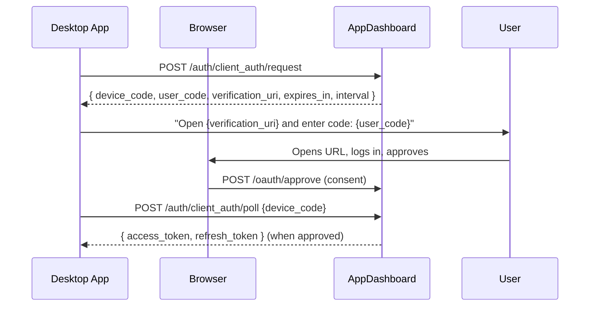

# Authentication & OAuth

**Web UI**: `/login`, `/register`, `/verify`, `/oauth/*` **API Base**: `/public-api/v1/auth`, `/public-api/v1/oauth` **Auth**: Session / Bearer / Device ID / OAuth

---

## Overview

AppDashboard implements **four authentication flows** for different client types:

| Flow | Clients | Token Type | Use Case |
|------|---------|------------|----------|
| **Session** | Web browser | Cookie (`session_id`) | Dashboard UI |
| **Bearer (Password Grant)** | Mobile apps, CLI, scripts | JWT Access + Refresh | API access |
| **OAuth 2.0 / OIDC** | Third-party apps, MCP | OAuth Access Token | SSO, delegated access |
| **Desktop Client Auth** | Native desktop apps | JWT via browser mediation | Secure native apps |

---

## Session Authentication (Web UI)

### Endpoints

| Method | Path | Description |
|--------|------|-------------|
| `GET` | `/login` | Login form |
| `POST` | `/login` | Process login (email/password + optional 2FA) |
| `GET` | `/logout` | Destroy session |
| `GET` | `/register` | Registration form |
| `POST` | `/register` | Create account + send verification email |
| `GET` | `/verify` | Email verification form |
| `POST` | `/verify` | Verify email token |
| `GET` | `/password/reset` | Request reset form |
| `POST` | `/password/reset` | Send reset email |
| `GET` | `/password/reset/{token}` | Reset form (token from email) |
| `POST` | `/password/reset/{token}` | Set new password |

### OAuth Login (Web)

```
GET /login?provider=google
→ Redirects to Google → Callback to /oauth/callback → Creates session
```

Supported providers: Configured in Admin → Config → OAuth Providers

---

## Bearer Token Authentication (API)

### Login (Password Grant)

```bash
curl -X POST https://your-domain.com/public-api/v1/auth/login \
  -H "Content-Type: application/json" \
  -H "X-Device-Id: $(uuidgen)" \
  -d '{"email":"user@example.com","password":"secret"}'
```

**Response**:
```json
{
  "access_token": "eyJ0eXAiOiJKV1QiLCJhbGciOiJSUzI1NiJ9...",
  "refresh_token": "eyJ0eXAiOiJKV1QiLCJhbGciOiJSUzI1NiJ9...",
  "expires_in": 3600,
  "token_type": "Bearer",
  "user": {
    "id": 1,
    "email": "user@example.com",
    "name": "John Doe",
    "roles": ["user"],
    "app_access": ["cloud", "films", "steps"]
  }
}
```

**Headers required**:
- `X-Device-Id`: Unique per client installation (UUID v4). Used for device tracking, revocation.
- `Content-Type: application/json`

### Refresh Access Token

```bash
curl -X POST https://your-domain.com/public-api/v1/auth/refresh \
  -H "Authorization: Bearer <refresh_token>"
```

Returns new `access_token` + `refresh_token` (rotation).

### Get Current User

```bash
curl -H "Authorization: Bearer <access_token>" \
  https://your-domain.com/public-api/v1/auth/me
```

### Revoke Token (Logout)

```bash
curl -X POST -H "Authorization: Bearer <access_token>" \
  https://your-domain.com/public-api/v1/auth/revoke
```

Revokes **both** access and refresh token for that device.

### Device Management

```bash
# List user's active devices
GET /public-api/v1/auth/devices

# Revoke specific device
DELETE /public-api/v1/auth/devices/{device_id}
```

---

## Desktop Client Auth (Browser-Mediated)

For native apps that **cannot securely store client secrets**.

### Flow



### Endpoints

| Method | Endpoint | Description |
|--------|----------|-------------|
| `POST` | `/auth/client_auth/request` | Start flow. Returns `device_code`, `user_code`, `verification_uri`, `verification_uri_complete`, `expires_in` (1800s), `interval` (5s) |
| `POST` | `/auth/client_auth/poll` | Poll for completion. Body: `device_code`. Returns tokens or `authorization_pending` / `slow_down` / `expired` / `access_denied` |

### Example (CLI)

```bash
# 1. Request
RESPONSE=$(curl -s -X POST https://your-domain.com/public-api/v1/auth/client_auth/request)
DEVICE_CODE=$(echo $RESPONSE | jq -r .device_code)
USER_CODE=$(echo $RESPONSE | jq -r .user_code)
VERIFICATION_URI=$(echo $RESPONSE | jq -r .verification_uri)

echo "Open: $VERIFICATION_URI"
echo "Code: $USER_CODE"

# 2. Poll
while true; do
  sleep 5
  RESULT=$(curl -s -X POST https://your-domain.com/public-api/v1/auth/client_auth/poll \
    -H "Content-Type: application/json" \
    -d "{\"device_code\":\"$DEVICE_CODE\"}")
  
  if echo $RESULT | jq -e '.access_token' > /dev/null; then
    ACCESS_TOKEN=$(echo $RESULT | jq -r .access_token)
    echo "Success! Token: $ACCESS_TOKEN"
    break
  elif echo $RESULT | jq -e '.error == "authorization_pending"' > /dev/null; then
    echo "Waiting for user..."
  else
    echo "Error: $(echo $RESULT | jq -r .error_description)"
    exit 1
  fi
done
```

---

## OAuth 2.0 / OpenID Connect (Third-Party Apps)

AppDashboard acts as **OAuth 2.0 Authorization Server** and **OpenID Provider**.

### Discovery

```
GET /.well-known/openid-configuration
GET /.well-known/oauth-authorization-server
```

Returns standard OIDC metadata (issuer, endpoints, scopes, claims, JWKS).

### Endpoints

| Endpoint | Path | Description |
|----------|------|-------------|
| **Authorization** | `GET /public-api/v1/oauth/authorize` | User consent screen |
| **Token** | `POST /public-api/v1/oauth/token` | Exchange code/refresh/client_credentials |
| **UserInfo** | `GET /public-api/v1/oauth/userinfo` | OIDC claims (requires `openid` scope) |
| **Revocation** | `POST /public-api/v1/oauth/revoke` | Revoke access/refresh token |
| **Introspection** | `POST /public-api/v1/oauth/introspect` | Validate token (RFC 7662) |
| **JWKS** | `GET /public-api/v1/oauth/jwks` | Public keys for JWT verification |
| **Client Management** | `GET/POST /public-api/v1/oauth/clients` | Admin: list/create OAuth clients |

### Authorization Code Flow (Web Apps)

```
1. Redirect user: GET /public-api/v1/oauth/authorize?
     response_type=code
     &client_id=YOUR_CLIENT_ID
     &redirect_uri=https://yourapp.com/callback
     &scope=openid profile email cloud
     &state=RANDOM_STRING
     &code_challenge=PKCE_CHALLENGE
     &code_challenge_method=S256

2. User logs in + consents → Redirects to:
   https://yourapp.com/callback?code=AUTH_CODE&state=RANDOM_STRING

3. Exchange code:
   POST /public-api/v1/oauth/token
     grant_type=authorization_code
     &code=AUTH_CODE
     &redirect_uri=https://yourapp.com/callback
     &client_id=YOUR_CLIENT_ID
     &client_secret=YOUR_SECRET
     &code_verifier=PKCE_VERIFIER

4. Response:
   {
     "access_token": "...",
     "refresh_token": "...",
     "id_token": "...",           // JWT with user claims
     "token_type": "Bearer",
     "expires_in": 3600,
     "scope": "openid profile email cloud"
   }
```

### Client Credentials Flow (Machine-to-Machine)

```
POST /public-api/v1/oauth/token
  grant_type=client_credentials
  &client_id=M2M_CLIENT_ID
  &client_secret=M2M_SECRET
  &scope=cloud films admin
```

Returns `access_token` only (no refresh, no id_token).

### Refresh Token

```
POST /public-api/v1/oauth/token
  grant_type=refresh_token
  &refresh_token=REFRESH_TOKEN
  &client_id=CLIENT_ID
  &client_secret=CLIENT_SECRET
```

### Scopes

| Scope | Grants Access To |
|-------|------------------|
| `openid` | OIDC `sub`, `name`, `email` in id_token/userinfo |
| `profile` | `name`, `avatar`, `locale`, `timezone` |
| `email` | `email`, `email_verified` |
| `cloud` | Cloud API (`/public-api/v1/cloud/*`) |
| `films` | Films API |
| `smart_home` | Smart Home API |
| `steps` | Steps API |
| `spends` | Spends API |
| `recipes` | Recipes API |
| `admin` | Admin API (admin users only) |
| `mcp` | MCP server access |

### PKCE (Required for Public Clients)

- Generate `code_verifier`: 43-128 char random string
- `code_challenge = BASE64URL(SHA256(code_verifier))`
- Send `code_challenge` + `code_challenge_method=S256` in authorize request
- Send `code_verifier` in token request

---

## OAuth Client Registration (Admin)

Admin → Configuration → **OAuth Clients** → **Add Client**:

| Field | Description |
|-------|-------------|
| Name | Display name (e.g., "My Mobile App") |
| Client ID | Auto-generated or custom |
| Client Secret | Auto-generated (confidential) or none (public) |
| Redirect URIs | One per line (must match exactly) |
| Grant Types | `authorization_code`, `refresh_token`, `client_credentials`, `device_code` |
| Scopes | Allowed scopes (subset of above) |
| Access Token Lifetime | Seconds (default: 3600) |
| Refresh Token Lifetime | Days (default: 30) |
| Require PKCE | On/Off (required for public clients) |
| Confidential | Yes (server-side) / No (SPA/mobile) |

---

## MCP OAuth (AI Assistants)

MCP clients use **OAuth 2.0 Client Credentials + User Consent**:

1. Register MCP client in Admin → OAuth Clients (grant `mcp` scope)
2. User connects AI assistant → redirects to `/public-api/v1/oauth/authorize?scope=mcp+cloud+films...`
3. User consents → AI gets `access_token` → calls `/mcp` JSON-RPC
4. MCP server validates token via introspection/JWKS

---

## Two-Factor Authentication (2FA)

**TOTP (RFC 6238)** — Google Authenticator, Authy, Bitwarden, etc.

### Web UI

1. Profile → **Two-Factor Authentication** → **Enable**
2. Scan QR code → Enter 6-digit code → Save **backup codes**

### API

| Method | Endpoint | Description |
|--------|----------|-------------|
| `POST` | `/auth/2fa/enable` | Start enrollment. Returns `secret`, `qr_code_uri`, `backup_codes[]` |
| `POST` | `/auth/2fa/confirm` | Verify first code. Body: `code` |
| `POST` | `/auth/2fa/disable` | Disable. Body: `code` (current TOTP) or `backup_code` |
| `GET` | `/auth/2fa/status` | Check if enabled |

**Login with 2FA** (Session):
```
POST /login
email=...&password=...&totp=123456
```

**Login with 2FA** (API Bearer):
```
POST /public-api/v1/auth/login
{ "email": "...", "password": "...", "totp": "123456", "device_id": "..." }
```

---

## Password Policy

Configured in Admin → Config → Security:

| Rule | Default |
|------|---------|
| Min length | 12 |
| Require uppercase | Yes |
| Require lowercase | Yes |
| Require number | Yes |
| Require symbol | Yes |
| Max age | 0 (never expires) |
| History | 5 previous passwords blocked |
| Breach check | HaveIBeenPwned API (optional) |

---

## Account Lockout

| Setting | Default |
|---------|---------|
| Max failed attempts | 5 |
| Lockout duration | 15 minutes |
| Lockout scope | Per IP + per account |

**Unlock**: Admin → Users → Edit → **Unlock Account** or wait for expiry.

---

## Troubleshooting

| Issue | Solution |
|-------|----------|
| "Invalid client" on token request | Check `client_id`/`client_secret`; ensure client exists in Admin → OAuth Clients |
| "Invalid redirect_uri" | Must match **exactly** (including trailing slash) one in client config |
| "Invalid scope" | Requested scope not allowed for client; check Admin → OAuth Clients → Scopes |
| PKCE verification failed | Ensure `code_challenge_method=S256`; `code_verifier` matches challenge |
| Refresh token expired | Re-authenticate (refresh tokens expire after 30 days default) |
| 2FA code rejected | Check time sync (server & device); try backup code; admin can reset via `/admin/users/{id}/2fa/reset` |
| Device ID missing | Include `X-Device-Id` header on `/auth/login`; generate UUID per app install |
| CORS error on OAuth | Add your domain to Admin → Config → Security → CORS Origins |